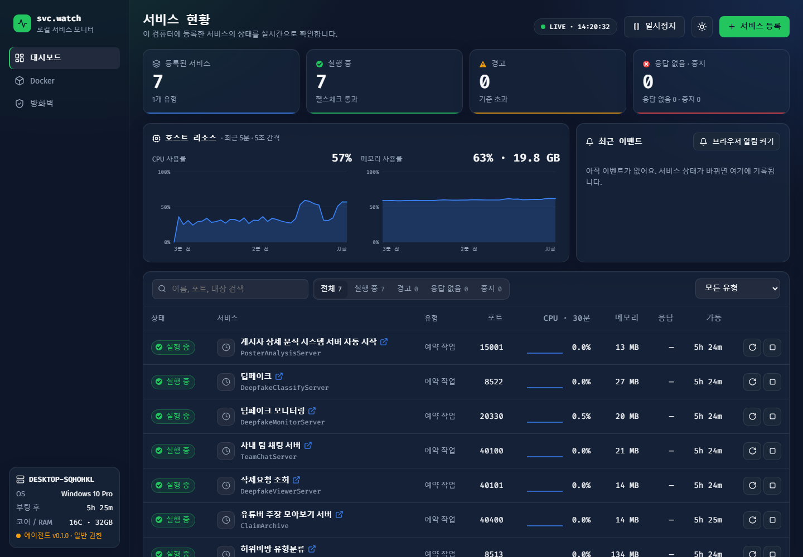
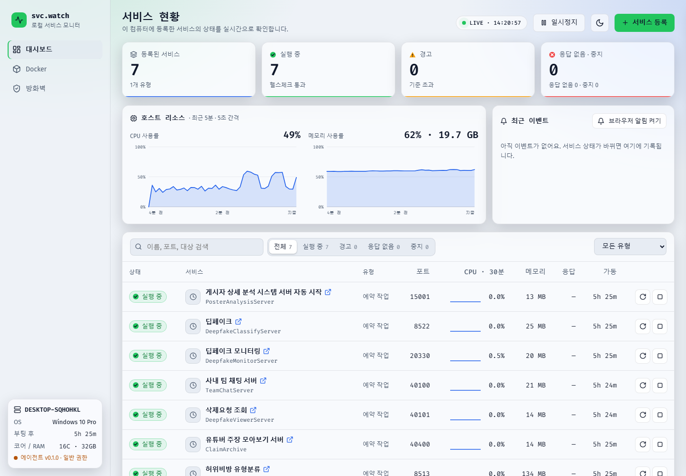
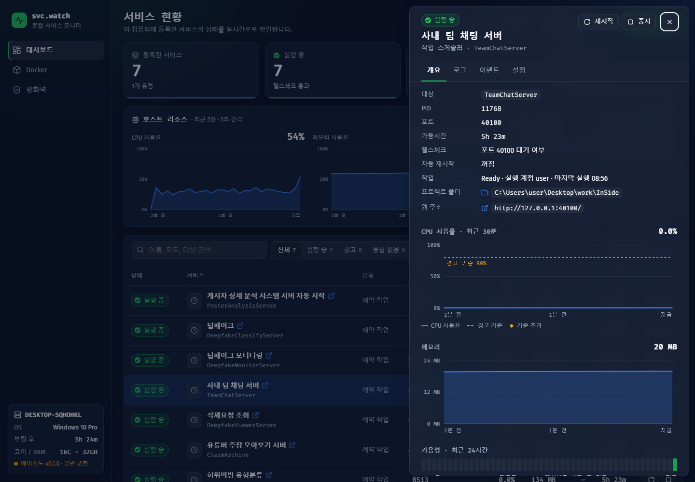
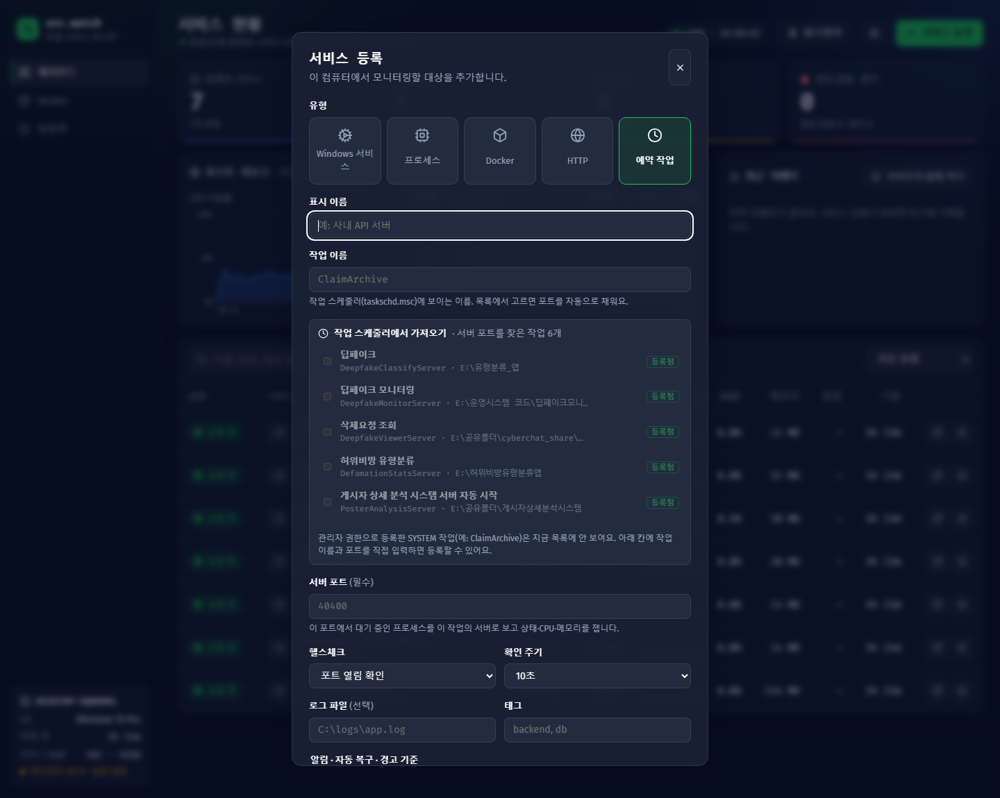
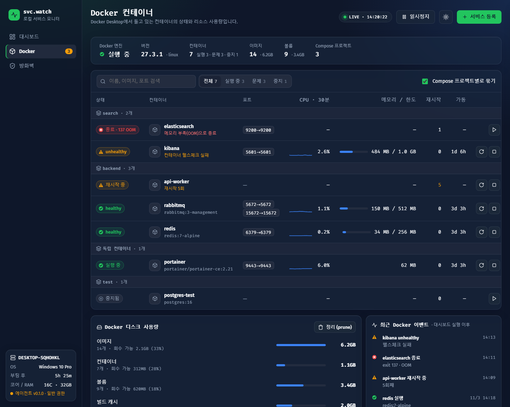
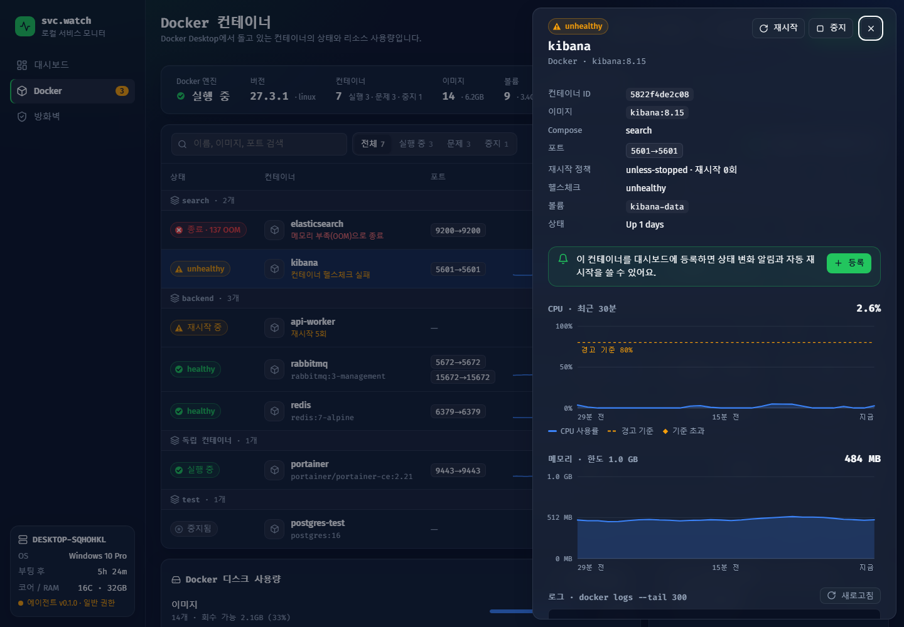
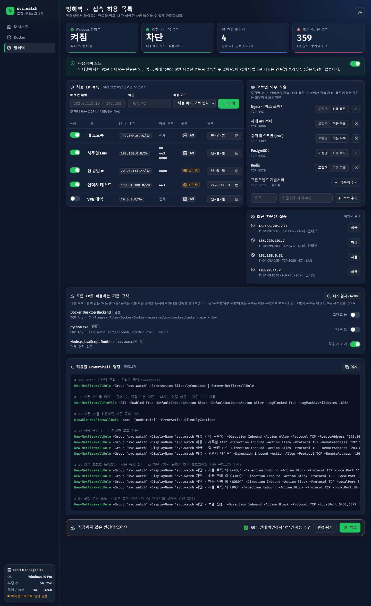

# svc-watch — 로컬 서비스 모니터

이 PC에서 돌아가는 서비스를 웹 대시보드 하나로 모니터링하고, Windows 방화벽을 "허용한 IP만 들어올 수 있게" 관리하는 도구입니다.
Windows 서비스 · 프로세스 · Docker 컨테이너 · HTTP 주소 · 작업 스케줄러로 띄운 앱을 모두 한 화면에서 봅니다.



---

## 빠른 시작

| 실행 파일 | 할 수 있는 것 |
|---|---|
| `run.bat` 더블클릭 | 모니터링, 프로세스·Docker·내 계정 예약 작업 제어, 방화벽 설정 미리보기 |
| `run-admin.bat` 더블클릭 (UAC 승인) | 위 기능 + Windows 서비스·SYSTEM 작업 제어, 방화벽 규칙 읽기·적용, 차단 로그 |

- 빌드 과정은 없습니다. 처음 실행할 때 `.venv` 가상환경을 만들고 `fastapi`, `uvicorn`, `psutil`을 설치합니다.
- 브라우저가 `http://127.0.0.1:8765`를 자동으로 엽니다. 포트를 바꾸려면 환경변수 `SVCWATCH_PORT`를 설정하세요.
- 필요한 것: Windows 10/11, Python 3.10 이상(PATH 등록). Docker 화면은 Docker Desktop이 실행 중일 때만 동작합니다.
- 다른 PC로 옮길 때는 `.venv` 폴더를 빼고 복사하세요. 가상환경은 PC마다 새로 만들어야 합니다.

---

## 화면 둘러보기

### 대시보드

등록한 서비스의 상태, CPU 30분 추이, 메모리, 포트, 가동시간을 한눈에 봅니다. 문제가 있는 서비스가 맨 위로 올라오고,
웹 페이지를 제공하는 서비스는 이름 옆 ↗ 아이콘을 누르면 바로 열립니다. 컬럼 제목을 누르면 정렬되고(한 번 더 누르면 반대로), 라이트 모드도 지원합니다.

<table>
<tr>
<td width="50%"></td>
<td width="50%"></td>
</tr>
<tr><td align="center">다크 모드</td><td align="center">라이트 모드</td></tr>
</table>

### 서비스 상세

행을 누르면 오른쪽에 상세 패널이 열립니다.

- **개요**: PID, 포트, 헬스체크, CPU·메모리 차트(경고 기준선 표시), 24시간 가용성
- **프로젝트 폴더**: 누르면 파일 탐색기에서 열립니다. 직접 입력하지 않으면 실행 중인 서버 위치에서 자동으로 찾고, 그 폴더의 `logs\*.log` 를 로그 탭에 보여 줍니다
- **웹 주소**: 서버가 켜져 있으면 링크가 생기고, 누르면 새 탭으로 열립니다
- **로그 · 이벤트 · 설정** 탭: 로그 파일 보기, 상태 변화 기록, 경고 기준·자동 재시작 설정



### 서비스 등록 · 작업 스케줄러에서 가져오기

유형을 고르고 대상을 입력합니다. **예약 작업** 유형을 고르면 작업 스케줄러에 등록된 앱 목록이 나오고,
각 앱의 프로젝트 폴더에서 돌고 있는 서버 포트를 자동으로 찾아 줍니다. 체크하고 한 번에 등록하면 됩니다.



> 관리자 권한으로 SYSTEM 계정에 등록한 작업(예: ClaimArchive)은 대시보드도 `run-admin.bat`으로 실행해야 목록에 보입니다.
> 일반 권한에서는 작업 이름과 포트를 직접 입력해 등록할 수 있습니다.

### Docker

> 아래 두 화면은 **예시 데이터**로 만든 화면입니다.

컨테이너를 Compose 프로젝트별로 묶어 보여 주고, healthy / unhealthy / 재시작 반복 / 메모리 부족(OOM) 종료를 구분합니다.
디스크 사용량과 정리(prune), 컨테이너별 로그도 볼 수 있습니다.

<table>
<tr>
<td width="50%"></td>
<td width="50%"></td>
</tr>
<tr><td align="center">컨테이너 목록 (예시)</td><td align="center">컨테이너 상세 (예시)</td></tr>
</table>

### 방화벽 · 허용 목록 모드

> 아래 화면은 **예시 데이터**로 만든 화면입니다.

인터넷에서 들어오는 연결을 막고, 허용 목록에 넣은 IP만 지정한 포트로 들어올 수 있게 합니다.



- **허용 IP 목록**: IP나 대역(CIDR)을 추가하고 켜고 끄며, 만료일을 정할 수 있습니다. LAN과 인터넷 주소를 자동으로 구분합니다
- **포트별 외부 노출**: `로컬만`(이 PC 안에서만) / `허용 목록` 중에서 고릅니다
- **강제 차단**: 허용 목록 포트에는 "목록 외 주소 차단" 규칙을 함께 만들어, 다른 프로그램의 "모든 IP 허용" 규칙이 있어도 뚫리지 않습니다
- **기존 규칙 검사**: 모든 IP를 허용하는 기존 규칙을 찾아 끄거나 되돌립니다
- **차단 로그**: 최근 차단된 접속을 보여 주고, 누르면 바로 허용 목록에 추가합니다
- **명령 미리보기**: 적용 전에 실제로 실행될 PowerShell 명령을 보여 줍니다

**안전장치**: 적용 직전에 `netsh advfirewall export`로 방화벽 설정 전체를 백업합니다. 60초 안에 "유지"를 누르지 않으면
서버가 자동으로 원래 설정으로 되돌립니다. 원격 접속이 끊겨도 원래대로 돌아오고, 백업은 `data/fw-backups/`에 최근 10개를 보관합니다.

svc-watch가 만든 규칙은 모두 `svc.watch` 그룹에 들어갑니다. 직접 지우려면 관리자 PowerShell에서 다음을 실행하세요.

```powershell
Get-NetFirewallRule -Group 'svc.watch' | Remove-NetFirewallRule
```

---

## 모니터링할 수 있는 대상

| 유형 | 대상 입력 | 상태 판단 | 시작 / 중지 |
|---|---|---|---|
| Windows 서비스 | 서비스 이름 (예: `Spooler`) | 서비스 상태 | `sc.exe` (관리자 권한) |
| 프로세스 | 이름 또는 명령줄 일부 | 일치하는 프로세스 존재 | 설정한 시작 명령 / 프로세스 종료 |
| Docker | 컨테이너 이름 | 컨테이너 상태 · health | `docker start/stop` |
| HTTP | URL | 응답 코드 · 응답시간 (+ 이 PC 주소면 그 포트의 서버 프로세스 CPU·메모리) | 시작 명령을 넣으면 시작 / 포트의 서버 종료 |
| 예약 작업 | 작업 이름 + 서버 포트 | 그 포트에서 대기 중인 서버 | 작업 다시 실행 / 서버 프로세스 종료 |

모든 유형에 다음을 설정할 수 있습니다.

- **추가 헬스체크**: TCP 포트 또는 HTTP 응답을 5초~5분 간격으로 확인
- **경고 기준**: CPU 사용률이 N%를 M분 넘게 유지되거나 응답시간이 기준을 넘으면 경고
- **알림과 자동 복구**: 자동 재시작(1시간에 최대 3회), 브라우저 알림

---

## 보안

- 서버는 `127.0.0.1`에서만 열려서, 다른 PC에서는 대시보드에 접속할 수 없습니다.
- 상태를 바꾸는 요청은 전용 헤더와 Origin을 확인합니다. 다른 웹사이트가 몰래 요청을 보내는 것(CSRF)과 DNS 리바인딩을 막습니다.
- 방화벽 명령에 들어가는 값(IP, 포트, 이름, 규칙 ID)은 서버에서 검증한 뒤 PowerShell 문자열로 이스케이프합니다.
- "폴더 열기"는 등록된 서비스의 폴더만 열 수 있습니다. 브라우저가 보낸 경로는 사용하지 않습니다.
- 프로세스 유형의 "시작 명령"은 입력한 그대로 셸에서 실행됩니다. 신뢰할 수 있는 명령만 넣으세요.

## 구조

```
backend/
  app.py         API (FastAPI) + 정적 파일 제공
  monitor.py     5초마다 서비스 상태·지표 수집, 이벤트, 자동 재시작
  system.py      Windows 서비스, 프로세스, 포트, 작업 스케줄러, PowerShell 실행
  docker_mon.py  docker CLI로 컨테이너 상태/통계/로그
  checks.py      TCP/HTTP 헬스체크, 웹 페이지 감지
  firewall.py    허용 목록 규칙 생성, 적용/백업/자동 복구, 충돌 규칙 검사, 차단 로그
  store.py       data/config.json 저장
frontend/        index.html · app.css · app.js (빌드 과정 없음)
data/            설정·이벤트·방화벽 백업 (git 제외)
docs/images/     README 스크린샷
mockup-v2.html   초기 디자인 목업
```

## 알아둘 점

- CPU·메모리 추이와 24시간 가용성은 대시보드가 켜져 있는 동안만 쌓이고, 다시 켜면 처음부터 쌓입니다. 이벤트 기록은 유지됩니다.
- 허용 IP의 만료일이 지나면 "다음에 적용할 때" 목록에서 빠집니다. 만료 시각에 자동으로 다시 적용되지는 않습니다.
- 대시보드를 꺼도 이미 적용한 방화벽 규칙은 그대로 남습니다. 꺼지면 모니터링과 자동 재시작만 멈춥니다.
- SYSTEM 계정으로 도는 서버는 관리자 권한이 아니면 CPU·메모리 일부와 프로젝트 폴더가 보이지 않습니다.
